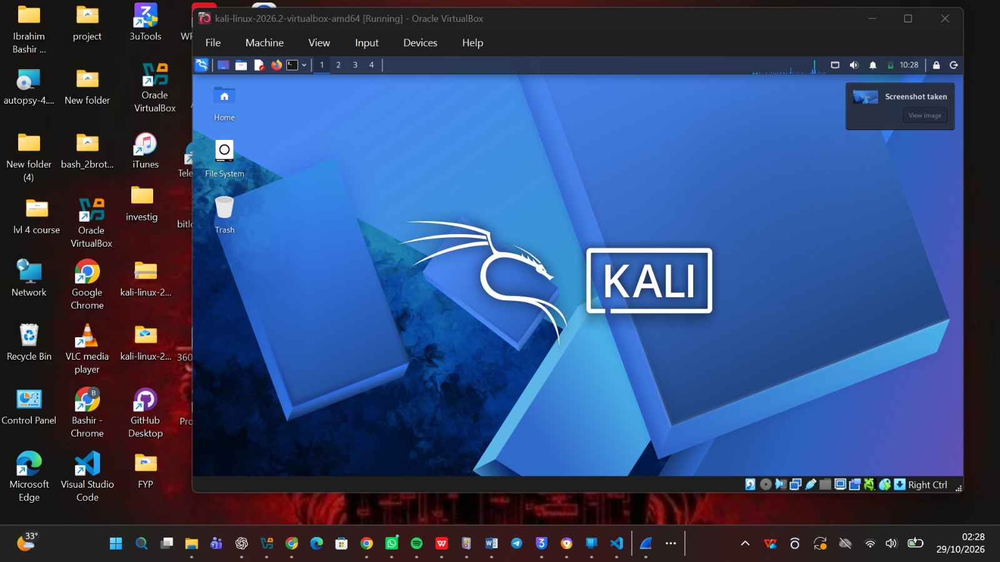
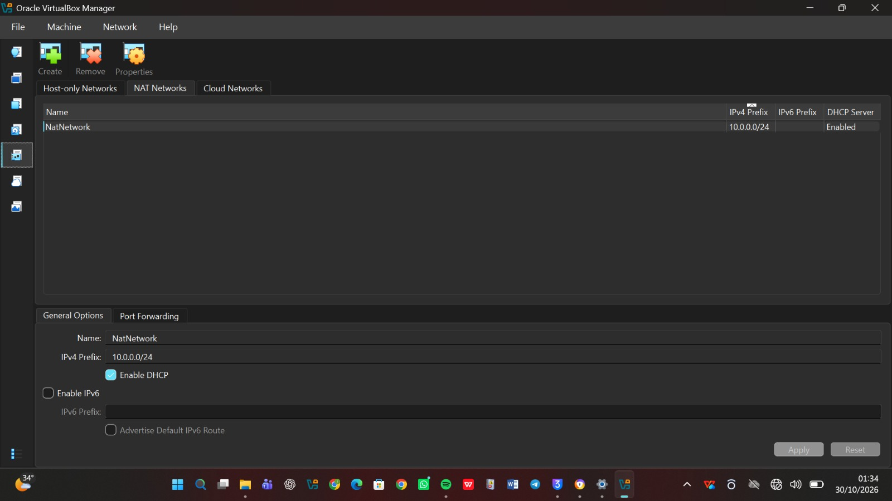
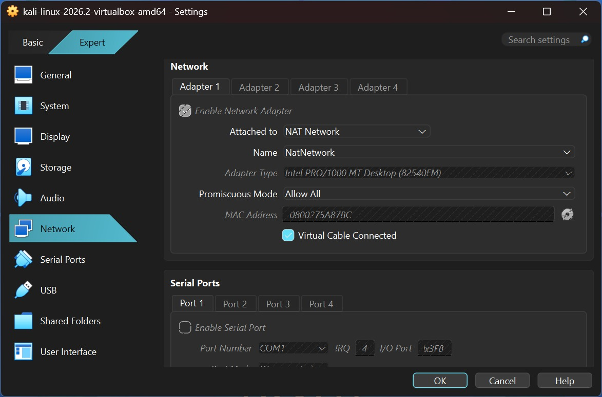

<div align="center">

# 🐉 Kali Linux Lab on VirtualBox

**A private, isolated virtual network for learning cybersecurity and ethical hacking**

*WK1-PM1 · Cybersecurity at Networkwalks · Week 01*

</div>

<p align="center">
  
  
  
  
  
  
</p>

---

## 📖 About This Project

This repository documents how I built my first **cybersecurity testing lab** as the Week 1 project of the Networkwalks cybersecurity program.

The lab runs entirely on my own Windows machine. **VirtualBox** hosts a **Kali Linux** virtual machine (my "attacker" machine), and both live on a private **NAT Network** so that more machines can be plugged in later and tested safely, without touching any real network.



*Kali Linux 2026.2 running as a VirtualBox guest on my Windows host.*

---

## ✅ Task Requirements & Status

| # | Requirement | Status |
|---|-------------|--------|
| 1 | Use VirtualBox as the base (latest recommended version) | ✅ Done |
| 2 | Set up Kali Linux as the attacker machine | ✅ Done |
| 3 | Network in subnet `10.0.0.0/24` | ✅ Done |
| 4 | Use a NAT Network with `10.0.0.0/24` | ✅ Done |
| 5 | Clipboard and file drag & drop enabled | ✅ Done |
| 6 | Shared folder: host `Downloads` folder shared with Kali | ✅ Done |
| 7 | Kali IP address set to `10.0.0.2/24` | ✅ Done |
| 8 | Kali has full Internet access | ✅ Done |
| 9 | Clean snapshot of the VM taken | ✅ Done |

---

## 🗺️ Lab Design

```text
            ┌──────────────────────────────────────────┐
            │          Windows Host (VirtualBox)       │
            │                                          │
            │    ┌─────────────────────────────┐       │
            │    │   NatNetwork  10.0.0.0/24   │       │
            │    │   Gateway: 10.0.0.1         │       │
            │    │                             │       │
            │    │   🐉 Kali Linux             │       │
            │    │      10.0.0.2/24            │       │
            │    │                             │       │
            │    │   (future VMs: .3 – .99)    │       │
            │    └──────────────┬──────────────┘       │
            └───────────────────┼──────────────────────┘
                                │  NAT
                             🌍 Internet
```

### Configuration Summary

| Item | Value |
|------|-------|
| Host OS | Windows 11 pro |
| Host RAM | 16 GB |
| Hypervisor | Oracle VirtualBox 7.2.22 |
| Guest OS | Kali Linux 2026.2 (amd64, prebuilt VirtualBox image) |
| Network type | NAT Network (`NatNetwork`) |
| Subnet | `10.0.0.0/24` |
| DHCP on NAT Network | Enabled |
| Kali static IP | `10.0.0.2/24` |
| Gateway | `10.0.0.1` |
| DNS | `8.8.8.8` |
| Adapter type | Intel PRO/1000 MT Desktop (82540EM) |
| Promiscuous mode | Allow All |

---

## 🛠️ Build Steps

### Step 1 · Install 7-Zip
Kali's prebuilt VirtualBox image is shipped as a compressed archive, so I installed 7-Zip first to extract it.
🔗 https://7-zip.org/download.html

### Step 2 · Install VirtualBox
I installed the latest recommended VirtualBox release on the Windows host.
🔗 https://virtualbox.org/wiki/Downloads

### Step 3 · Create the NAT Network

In VirtualBox: **File → Tools → Network → NAT Networks → Create**, then set:

```text
Name:         NatNetwork
IPv4 Prefix:  10.0.0.0/24
DHCP:         Enabled
IPv6:         Disabled
```



*NatNetwork created with prefix `10.0.0.0/24` and DHCP enabled.*

I chose a NAT Network instead of plain NAT because machines on the same NAT Network can talk to each other **and** still reach the Internet. That is exactly what a multi-VM attack/target lab needs.

### Step 4 · Download and Import Kali Linux
I downloaded the Kali VirtualBox image from the official site, extracted it with 7-Zip, and opened the `.vbox` file in VirtualBox.
🔗 https://kali.org/get-kali

Then I attached the VM to the lab network under **Settings → Network → Adapter 1**:

```text
Attached to:      NAT Network
Name:             NatNetwork
Adapter type:     Intel PRO/1000 MT Desktop (82540EM)
Promiscuous mode: Allow All
Cable connected:  Yes
```



*Adapter 1 attached to NatNetwork.*

The same settings, opened while the VM was running:

![Adapter settings with the VM running] (4-kali-vm-adapter-while-running.jpg)

### Step 5 · Enable Clipboard, Drag & Drop and the Shared Folder

- **Devices → Shared Clipboard → Bidirectional**
- **Devices → Drag and Drop → Bidirectional**
- **Settings → Shared Folders:** added my host `Downloads` folder with *Auto-mount* enabled

<!-- 📸 ADD SCREENSHOT: images/5-shared-folder-and-clipboard.png -->

### Step 6 · Set the Static IP on Kali

In Kali: **Network icon → Edit Connections → Wired connection 1 → IPv4 Settings**

```text
Method:   Manual
Address:  10.0.0.2
Netmask:  24
Gateway:  10.0.0.1
DNS:      8.8.8.8
```

<!-- 📸 ADD SCREENSHOT: images/6-kali-static-ip.png -->

### Step 7 · Take a Snapshot
Once everything worked, I took a VirtualBox snapshot named `Clean Kali - Lab Setup` so I can always roll back to a known-good state.

<!-- 📸 ADD SCREENSHOT: images/7-snapshot.png -->

---

## 🔎 Verification

Run these inside Kali to prove the lab works:

| Check | Command | What you should see |
|-------|---------|---------------------|
| IP address | `ip a` | `10.0.0.2/24` on the Ethernet interface |
| Gateway | `ping -c 4 10.0.0.1` | Replies received |
| Internet | `ping -c 4 8.8.8.8` | Replies received |
| DNS | `ping -c 4 kali.org` | Name resolves, replies received |
| Shared folder | `ls /media` (or your mount point) | Host Downloads contents visible |

<!-- 📸 ADD SCREENSHOT: images/8-ping-tests.png -->

---

## 🧯 Troubleshooting

**Kali has no Internet after setting the static IP.**
This is a known issue with newer VirtualBox 7 and Kali 2026.x builds. The course material gives this fix:

```bash
sudo nmcli connection modify "Wired connection 1" ipv4.dad-timeout 0
sudo nmcli connection down "Wired connection 1"
sudo nmcli connection up "Wired connection 1"
```

Other things to check:

1. The NAT Network exists and uses `10.0.0.0/24`.
2. The VM adapter is attached to that exact NAT Network.
3. No other VM on the same network already uses `10.0.0.2`.
4. If DNS fails with `8.8.8.8`, try `10.0.0.1` as the DNS server instead.
5. Restart the VM, then the host, if it still fails.

<!-- Add any real problems you hit while building the lab here, with how you solved them. -->

---

## 🎓 What I Learned

- **NAT vs NAT Network:** plain NAT isolates each VM; a NAT Network lets VMs share one private subnet while still getting Internet access.
- **Static addressing:** how an IP, netmask, gateway and DNS server work together, and why a fixed IP makes lab documentation easier.
- **Snapshots:** take a clean one *before* experimenting, so mistakes are cheap to undo.
- **Documentation:** screenshots, commands and fixes are part of the work, not an afterthought.

---

## 🔮 Next Steps

Add more VMs to the same NAT Network (for example Windows 10/11 or Android) using fixed IPs in the `10.0.0.3–10.0.0.99` range, ping-test them from Kali, and snapshot each one.

---

## ⚠️ Ethical Use

This lab is for **learning only**. Only test systems that you own or have written permission to test.

---

## 👤 Author

**Muhammad**
Cybersecurity student 

**Program:** Cybersecurity Intern at Networkwalks · **Week:** 01 · **Project:** WK1-PM1 Lab Setup
